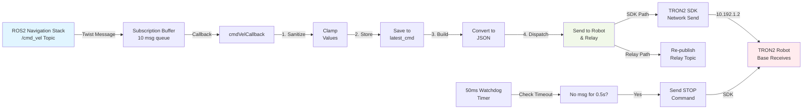

# TRON2 Cmd Vel Translator Node - Flowchart

## Node Architecture Flowchart

## Detailed Data Flow



        ROS2 /cmd_vel topic
                ↓
        [cmdVelCallback]
                ↓
        [sanitizeCmd] — Clamp velocities
                ↓
        [buildJson] — Convert to JSON format
                ↓
        [robot_->publishJsonMessage] — Send via SDK
                ↓
        TRON2 Robot (via network @ 10.192.1.2)

---

### ###################################### ###
### How to launch tron2_cmd_vel_translator ###
### ###################################### ###
```bash
# Onboard translator (SDK direct from robot PC)
ros2 launch limxsdk_lowlevel tron2_cmd_vel_translator.launch.py mode:=onboard robot_ip:=10.192.1.2

# Offboard relay (Jazzy PC relays /cmd_vel to /tron2/cmd_vel)
ros2 launch limxsdk_lowlevel tron2_cmd_vel_translator.launch.py mode:=offboard_relay

# Onboard bridge consumer (robot PC listens to /tron2/cmd_vel and sends SDK)
ros2 launch limxsdk_lowlevel tron2_cmd_vel_translator.launch.py mode:=onboard_bridge_consumer robot_ip:=10.192.1.2

# Offboard direct SDK (Jazzy PC sends SDK directly if network allows)
ros2 launch limxsdk_lowlevel tron2_cmd_vel_translator.launch.py mode:=offboard_direct robot_ip:=10.192.1.2
```
### End of launch examples for tron2_cmd_vel_translator ###

## Key Points

### 🎯 **Core Functionality**
1. **Bridges ROS2 to TRON2**: Converts standard ROS2 `Twist` messages into proprietary JSON commands
2. **Active Command Push**: Node actively sends commands to robot; robot doesn't subscribe to ROS2 topics
3. **Network-Based**: Communicates via TCP/IP to robot IP (default: `10.192.1.2`)

### 🛡️ **Safety Mechanisms**
1. **Velocity Clamping**: Prevents commands exceeding configured limits:
   - `max_linear_x`: 0.6 m/s (forward/backward)
   - `max_linear_y`: 0.4 m/s (strafe left/right)
   - `max_angular_z`: 1.2 rad/s (rotation)

2. **Deadman Switch**: 50ms watchdog timer monitors incoming commands:
   - If no cmd_vel received for 0.5 seconds → automatically sends STOP command
   - Prevents runaway if control link is lost
   - Prevents repeated stop messages if already stopped

### 📊 **Command Translation**
- **Input**: ROS2 `geometry_msgs/Twist` (6 DOF float values)
- **Processing**: Sanitize → Format → JSON template substitution
- **Output**: JSON string with fields:
  - `accid`: "nav_bridge" (source identifier)
  - `title`: "request_twist" (command type)
  - `timestamp`: milliseconds since epoch
  - `guid`: sequence number for tracking
  - `data`: velocity values (linear_x, linear_y, angular_z)

### 🔄 **Dual Output Modes**
1. **SDK Output** (`enable_sdk_output=true`): Sends commands directly to physical robot
2. **Relay Output** (`enable_relay_output=true`): Re-publishes on different ROS2 topic for:
   - Debugging/monitoring
   - Logging command flow
   - Testing without robot connection

### ⚙️ **Configurable Parameters**
```yaml
enable_sdk_output: true          # Send to physical robot
enable_relay_output: false       # Re-publish for debugging
cmd_vel_topic_in: /cmd_vel       # Input subscription topic
cmd_vel_topic_out: /tron2/cmd_vel # Output relay topic
robot_ip: 10.192.1.2             # Robot network address
max_linear_x: 0.6                # Max forward velocity (m/s)
max_linear_y: 0.4                # Max strafe velocity (m/s)
max_angular_z: 1.2               # Max rotation velocity (rad/s)
deadman_timeout_s: 0.5           # Safety timeout (seconds)
sdk_json_template: {...}         # JSON format string
```

### 🔗 **Integration Points**
- **Upstream**: Any ROS2 node publishing to `/cmd_vel` (e.g., navigation stack, teleop)
- **Downstream**: TRON2 robot base (via network)
- **Optional**: Relay subscribers listening to `/tron2/cmd_vel` for monitoring

### 📈 **Sequence of Events**
1. **Initialization**: Load config → Connect to robot → Setup subscriptions & timer
2. **Per Command**: Receive → Sanitize → Convert → Send (all ~1ms)
3. **Every 50ms**: Watchdog checks for timeout
4. **On Timeout**: Send zero command to stop robot (safety failsafe)

---

## Debug Tips

| Issue | Probable Cause | Solution |
|-------|----------------|----------|
| "Failed to initialize TRON2 SDK" | Can't reach robot | Check `robot_ip`, network connectivity |
| Robot doesn't move | SDK output disabled | Set `enable_sdk_output: true` |
| Commands ignored | Velocity clamped to zero | Increase max_* parameters |
| Sudden stops every 0.5s | Deadman timeout triggering | Increase `deadman_timeout_s` or check cmd_vel publishing rate |
| Can't see commands | Relay not enabled | Set `enable_relay_output: true` and monitor `/tron2/cmd_vel` |

